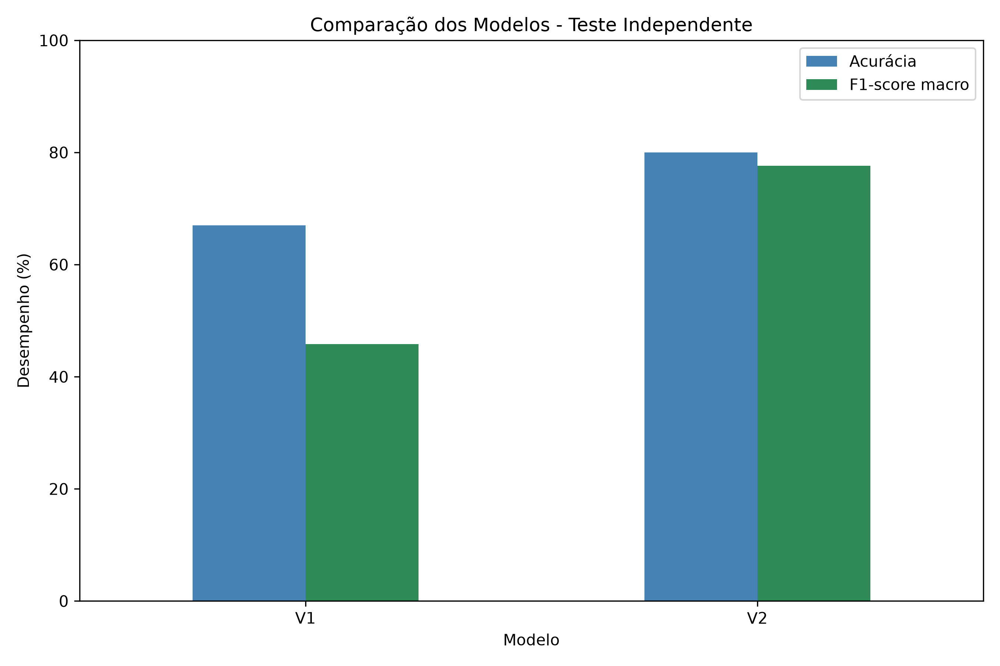
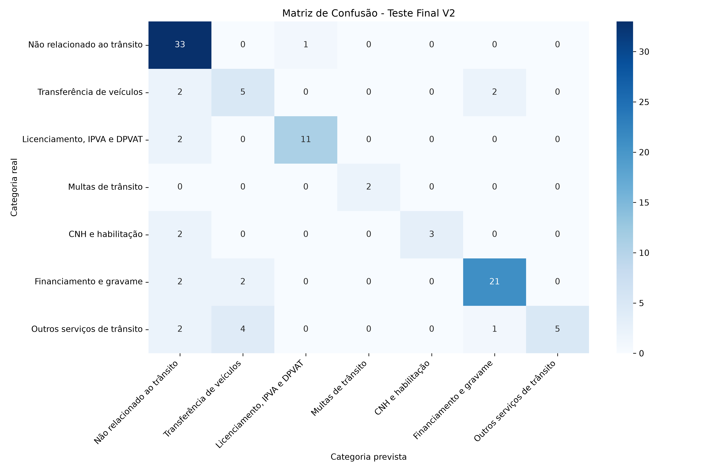

# Trânsito IA

## Análise Inteligente de Reclamações sobre Serviços de Trânsito

### Informações acadêmicas

- Instituição: UNOESC
- Curso: Ciência de Dados e Inteligência Artificial
- Disciplina: Projeto de IA
- Acadêmico: Gabriel Rossi Moras
- Ano: 2026

## Objetivo

Classificar automaticamente reclamações relacionadas
a serviços de trânsito utilizando técnicas de
Processamento de Linguagem Natural (PLN)
e aprendizado de máquina.

## Base de dados

ConsumerBR — base pública de reclamações de consumidores.

https://zenodo.org/records/18022568

- Registros analisados: 3.150.552
- Registros filtrados: 11.085
- Registros após limpeza: 11.001
- Registros rotulados manualmente: 406
- Registros destinados ao teste independente: 100

## Tecnologias utilizadas

- Python
- Pandas
- Scikit-learn
- TF-IDF
- Regressão Logística
- Aprendizado ativo
- Matplotlib
- Seaborn
- Streamlit
- Joblib

## Categorias de classificação

1. Não relacionado ao trânsito
2. Transferência de veículos
3. Licenciamento, IPVA e DPVAT
4. Multas de trânsito
5. CNH e habilitação
6. Financiamento e gravame
7. Outros serviços de trânsito

## Resultados

Os dois modelos foram avaliados utilizando
100 reclamações de um conjunto de teste independente.

| Indicador | Modelo V1 | Modelo V2 |
|---|---:|---:|
| Acurácia | 67% | 80% |
| F1-score macro | 0,4583 | 0,7761 |
| Acertos | 67 | 80 |
| Erros | 33 | 20 |

O modelo V2 apresentou uma melhoria de
13 pontos percentuais na acurácia.

## Comparação dos modelos



## Matriz de confusão final



## Interface do sistema

A aplicação desenvolvida em Streamlit permite:

- Inserir textos de reclamações.
- Identificar a categoria prevista.
- Visualizar probabilidades estimadas.
- Alertar sobre classificações de baixa confiança.
- Consultar os resultados dos modelos.

## Como executar

Instalar as dependências:

```bash
python -m pip install -r requirements.txt
```

Executar a aplicação:

```bash
python -m streamlit run app.py
```

## Limitações

O modelo possui caráter experimental e apresenta
limitações devido à quantidade de registros rotulados
e à distribuição desigual entre as categorias.

As classificações não substituem a análise humana.

Os arquivos contendo os textos das reclamações
não são distribuídos neste repositório.

## Finalidade

Projeto acadêmico desenvolvido para a disciplina
de Projeto de Inteligência Artificial da UNOESC.